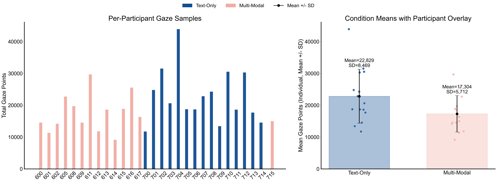

# Believe It. Engage It.

A Mixed Reality Dataset of Engagement, Cognitive Load, Physical Load, Cybersickness, and Task Performance Under Cognitive Attack

## Abstract

Mixed Reality (MR) systems are increasingly deployed in safety critical domains such as medical training and emergency response, where users must interpret automated system guidance while performing complex physical and cognitive tasks. In these high-stakes environments, misleading system feedback can disrupt user engagement and degrade task performance. Such disruptions may occur when incorrect guidance is presented through different interface modalities, including textual instructions, visual overlays, or spoken prompts, which can confuse users, increase cognitive load, and interfere with correct procedural execution. However, existing research lacks comprehensive resources that systematically vary these deceptive guidance modalities and their intensity to study their behavioral impact.

To address this gap, we introduce a mixed reality dataset and machine learning benchmark that captures user behavior under deceptive system feedback during a Tactical Combat Casualty Care training scenario. We collected behavioral telemetry from 29 participants exposed to misleading textual, visual, and auditory interface cues while interacting with the MR system, recording synchronized eye gaze trajectories, field-of-view traces, and detailed behavioral interaction logs. The dataset also includes comprehensive psychometric profiling from 17 validated instruments that measure baseline traits such as self-efficacy and locus of control, together with continuous subjective workload and presence scores.

Statistical analysis reveals a highly significant behavioral adaptation effect (p < .001), indicating that participants progressively learned to filter misleading MR guidance and recover task efficiency over time. To establish a predictive baseline, we evaluated several machine learning models. The results show that an Explainable Boosting Machine classifier achieves more than 80% accuracy and a micro area under the curve score of 0.92 for detecting engagement degradation using continuous gaze and interaction signals. By releasing this open dataset together with strong predictive baselines, this work provides a valuable resource for studying engagement dynamics and developing anomaly-aware models for immersive systems.

## Dataset Characteristics

### Participants
29 participants (25 male, 4 female)
Age range: 19-32 years
Diverse ethnic backgrounds: Asian, White, Hispanic or Latino, Black or African American, and multiracial
Educational backgrounds: Associate to Master's level programs
VR/AR experience: varied from no previous exposure to more than 100 sessions

### Experimental Conditions
Text-Only Condition: 15 participants
Multi-Modal Condition: 14 participants

Attack Intensity Levels: Low, Medium, High
Session Duration: 20-30 minutes per participant
Task Steps: 30 consecutive steps in TCCC scenario

### Data Volume and Density



Total Gaze Points Collected: 584,688 samples
Text-Only Dataset: 342,434 gaze points (mean = 22,829, SD = 8,469)
Multi-Modal Dataset: 242,254 gaze points (mean = 17,304, SD = 5,712)
Average Sampling Rate: approximately 20,000 gaze samples per participant

### Data Streams

Interaction and Behavioral Logs
- Task step timestamps
- Activity transitions
- User responses during navigation and selection
- Task type metadata
- Step duration
- Number of attempts
- Response correctness

Eye Gaze and Field-of-View Traces
- High-frequency eye gaze telemetry from HoloLens 2
- 3D gaze origin and direction vectors
- Head position and orientation
- Field-of-view object traces
- Visible object tracking

Visual Scene Features
- Brightness flicker
- Contrast measurements
- Spatial frequency
- Edge intensity
- Histogram of Oriented Gradients (HOG) descriptors

Task Performance Metrics
- Discovery Activity
- Locate and Select Activity
- Multiple Choice Activity
- Navigation Activity
- Timer Activity

Self-Report Measures (17 validated instruments)
- NASA Task Load Index (NASA-TLX)
- Presence Questionnaire (PQ)
- System Usability Scale (SUS)
- Trust in Automation (TIA)
- User Engagement Scale (UES)
- Simulator Sickness Questionnaire (SSQ)
- Visual Fatigue Questionnaire (VFQ)
- Locus of Control (LoC)
- Self-Efficacy Scale (SES)
- Embedded Figures Test

### Descriptive Statistics

Subjective Experience Metrics (Mean and SD):

Text-Only Condition (n=15):
- Presence (PQ): 59.33 ± 8.21
- Usability (SUS): 65.93 ± 11.26
- Engagement (UES): 3.07 ± 0.26
- Total Workload (NASA-TLX): 6.46 ± 3.70
- Trust in Automation (TIA): 7.87 ± 1.46

Multi-Modal Condition (n=14):
- Presence (PQ): 62.21 ± 10.09
- Usability (SUS): 68.29 ± 19.59
- Engagement (UES): 3.21 ± 0.58
- Total Workload (NASA-TLX): 5.90 ± 4.54
- Trust in Automation (TIA): 8.00 ± 2.25

Task Performance Accuracy:
- Discovery Activity: 100.00% (Multi-Modal), 99.17% (Text-Only)
- Locate & Select Activity: 71.43% (Multi-Modal), 67.13% (Text-Only)
- Multiple Choice Activity: 73.21% (Multi-Modal), 74.44% (Text-Only)
- Navigation Activity: 71.43% (Multi-Modal), 85.67% (Text-Only)

### Key Findings

Temporal Adaptation Effect
Participants demonstrated significant behavioral adaptation over time:
- Text-Only: First half mean = 64.33s, Second half mean = 22.46s (p < 0.001)
- Multi-Modal: First half mean = 72.45s, Second half mean = 43.67s (p < 0.001)

Physiological Strain
- Significant increase in overall SSQ Total score (p = 0.003)
- Highly significant increase in Oculomotor strain (p < 0.001)
- No significant increase in Nausea or Disorientation
- Confirms ecological validity of HoloLens 2 simulation

## Machine Learning Case Studies

### Engagement Classification Models

Three-class engagement classification (Low, Medium, High):

Model Performance (Mean ± SD across folds):

Explainable Boosting Machine (EBM):
- Accuracy: 0.8056 ± 0.0647
- Balanced Accuracy: 0.8059 ± 0.0648
- Macro-F1: 0.8041 ± 0.0655
- Micro-AUC: 0.9270 ± 0.0309

XGBoost:
- Accuracy: 0.7988 ± 0.0309
- Balanced Accuracy: 0.7989 ± 0.0315
- Macro-F1: 0.7959 ± 0.0305
- Micro-AUC: 0.9365 ± 0.0287

Random Forest:
- Accuracy: 0.7955 ± 0.0440
- Balanced Accuracy: 0.7962 ± 0.0439
- Macro-F1: 0.7925 ± 0.0446
- Micro-AUC: 0.9190 ± 0.0372

Decision Tree:
- Accuracy: 0.6999 ± 0.0569
- Balanced Accuracy: 0.7003 ± 0.0576
- Macro-F1: 0.6990 ± 0.0543
- Micro-AUC: 0.7750 ± 0.0426

### Engagement Regression Models

Continuous engagement estimation:

XGBoost Regressor:
- MAE: 0.5240 ± 0.0186
- RMSE: 0.7293 ± 0.0354
- R²: 0.4833 ± 0.0425
- Pearson r: 0.7027 ± 0.0337

Random Forest Regressor:
- MAE: 0.5301 ± 0.0244
- RMSE: 0.7353 ± 0.0375
- R²: 0.4745 ± 0.0485
- Pearson r: 0.6948 ± 0.0374

Decision Tree Regressor:
- MAE: 0.5480 ± 0.0288
- RMSE: 0.7670 ± 0.0535
- R²: 0.4279 ± 0.0688
- Pearson r: 0.6693 ± 0.0477

## Repository Structure

models/
- Trained engagement classification models
- Training scripts with hyperparameter optimization
- Automation scripts for one-click model training
- Documentation and requirements

comprehensive_analysis.ipynb
- Comprehensive statistical analysis of the dataset

gaze_data_density_analysis.ipynb
- Gaze data visualization and density analysis

task_performance_mean_sd_modalities.ipynb
- Task performance analysis across modalities

two_stage_escalation_experiment.py
- Two-stage escalation experimental analysis

## Model Training

All models are trained with hyperparameter optimization using RandomizedSearchCV. The training scripts support:
- LSTM: Binary engagement classification with bidirectional layers
- GRU: Lightweight alternative to LSTM
- XGBoost: Gradient boosting for 3-class classification
- Random Forest: Ensemble classifier with bagging
- Decision Tree: Interpretable single-tree classifier
- EBM: Explainable Boosting Machine for glass-box interpretability

To train all models:

On Windows (PowerShell):
```
cd models
.\train_all_models.ps1
```

On Windows (Command Prompt):
```
cd models
train_all_models.bat
```

Cross-platform (Python):
```
cd models
python run_all_models.py
```

## Requirements

Python 3.8+
numpy >= 1.24.0
pandas >= 2.0.0
scikit-learn >= 1.3.0
keras >= 3.0.0
jax >= 0.4.0
jaxlib >= 0.4.0
xgboost >= 2.0.0
interpret >= 0.5.0 (optional, for EBM)
matplotlib >= 3.7.0
seaborn >= 0.12.0

Install all dependencies:
```
pip install -r models/requirements.txt
```

## Citation

If you use this dataset in your research, please cite:

```
@article{believeit2026,
  title={Believe It. Engage It.: A Mixed Reality Dataset of Engagement, Cognitive Load, Physical Load, Cybersickness, Task Performance Under Cognitive Attack},
  year={2026},
  note={ISMAR 2026 Submission ID: 1359}
}
```

## License

This dataset is released for research purposes.

## Contact

For questions or issues regarding the dataset, please open an issue in this repository.
